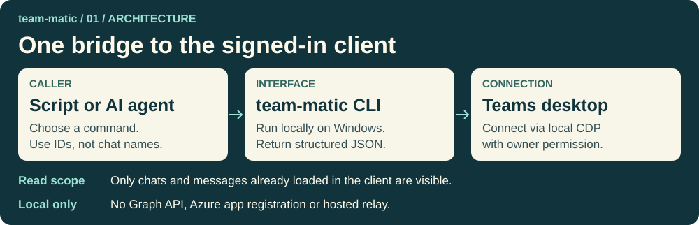
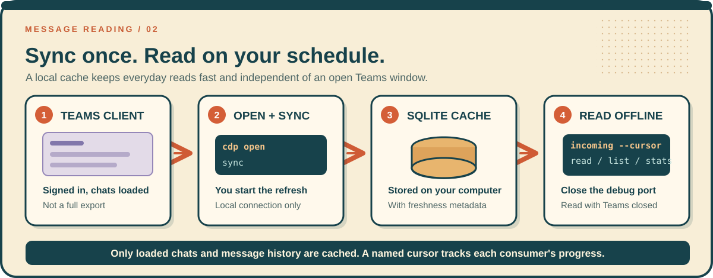
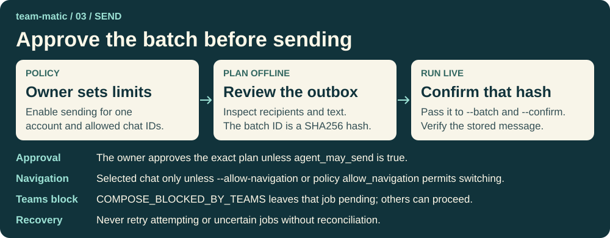

<h1 align="center">TEAM-MATIC</h1>

<p align="center">
  <strong>Your Teams chats. Your scripts. Your AI agents. You stay in control.</strong>
</p>

<p align="center">
  
</p>

<p align="center">
  Turn the Microsoft Teams desktop app you already use into a <strong>local, scriptable inbox</strong>.<br>
  Read loaded chats, detect new messages and send carefully approved replies.<br>
  <strong>No Graph API. No Azure app. No bot registration. No hosted relay.</strong>
</p>

<p align="center">
  
  
  
  <a href="LICENSE"></a>
</p>

<p align="center">
  <a href="#quick-start">Quick start</a> ·
  <a href="#how-it-works">How it works</a> ·
  <a href="#read-messages">Read messages</a> ·
  <a href="#send-with-approval">Send safely</a> ·
  <a href="#documentation">Documentation</a>
</p>

> [!IMPORTANT]
> **Experimental, provided as is, no warranty.** Verified live on one personal Teams account (Windows 11, Polish UI). Work or school accounts and other UI languages are untested, not known to be incompatible. A Teams update can break it; guards then stop instead of guessing. See [verification](docs/VERIFICATION.md).

---

## One local bridge. Three useful superpowers.

| READ | SEND | AUTOMATE |
| :--- | :--- | :--- |
| Read your Teams chats **live** from the desktop app and pick up new incoming messages. Named cursors let each consumer track its own progress. | Prepare **plain or formatted** messages, preview recipients and text, then send only after a human approves the exact batch. | Run a **JSON-in / JSON-out** CLI from Python scripts, Task Scheduler or AI coding agents. A ready-to-install skill is included. |
| `list` · `incoming` · `read` | `plan` · `run` · `reconcile` | [Agent skill](skills/team-matic/SKILL.md) · [Examples](examples/) |

**Made for your own signed-in desktop session**, not for scraping Microsoft servers or sending unsolicited messages. Every command runs once and exits. Nothing is installed as a daemon.

## Quick start

**You'll need:** Windows 10/11, the **new Microsoft Teams desktop client** (signed in), Python 3.10+ and Node.js 22+. No third-party packages are required.

```powershell
git clone https://github.com/mike-argio/team-matic.git
cd team-matic

python teammatic.py doctor         # Check your setup and required software
python teammatic.py cdp open       # Restart Teams with a temporary local debug port
python teammatic.py list           # See chat IDs, read live from Teams
python teammatic.py incoming --limit 10
python teammatic.py cdp close      # Close the port and restart Teams normally
```

> [!WARNING]
> **`cdp open` restarts Teams and exposes a powerful, unauthenticated local debug port.** Other programs running under your Windows account may control the Teams session while it is open. Only open it deliberately, on a trusted computer, and close it afterwards. Reads are live by default, so they need the port; to read with the port closed, save an offline copy with `sync` first and add `--offline`.

Team-matic sees only the chats and messages the client has **loaded**, not your full Teams history. Open or scroll older conversations in Teams to load more.

## How it works



**Reading** takes the messages the Teams client has loaded, live, and returns JSON. No message copy is written to disk unless you run `sync`. Only a small `state.json` (your account id, chat names, cursor positions) and the send log stay in `data/`. **Sending** operates the actual Teams message composer through the desktop client's local debug interface, checking the recipient, draft and stored message. Team-matic never calls Microsoft Graph or extracts authentication cookies or tokens.

The local connection needs to be open for live reads, `sync` and `run`. Close it when you are done. Everything team-matic keeps lives under git-ignored `data/`.

## Read messages



With the port open, every read comes live from the running client:

```powershell
python teammatic.py list
python teammatic.py read --chat <chat_id> --limit 50
python teammatic.py incoming --chat <chat_id>
python teammatic.py stats
```

Need to process only new messages? Give each script or agent its own **named cursor**:

```powershell
python teammatic.py incoming --cursor my-agent --commit  # Create it; the existing backlog is skipped
python teammatic.py incoming --cursor my-agent           # Later: messages since the last commit
python teammatic.py incoming --cursor my-agent --commit  # Commit AFTER processing
```

Want to read with the port closed, for example from a scheduled job? Save an offline copy once, then add `--offline` to `list`, `read`, `incoming` or `stats`:

```powershell
python teammatic.py sync                     # Port open: write data/teams_bridge.sqlite3
python teammatic.py incoming --offline       # Port closed: read that copy
```

Every result says where it came from (`source`: `live` or `offline`) and, for the offline copy, how old it is.

[Full reading and cursor guide](docs/OPERATING_GUIDE.md#how-cache-and-cursors-work) · [Working example](examples/new_messages.py)

## Send with approval



Team-matic separates **preparing a message** from **sending it**. A script or agent can prepare the draft, but it cannot grant itself permission or approve its own plan.

**1. Configure your allowlist.** You, not an agent, enable sending and set the allowed `chat_id` values and limits.

```powershell
python teammatic.py init
python teammatic.py whoami
# Edit data/send-policy.json yourself; it starts disabled.
```

**2. Preview the exact batch.** Replace the placeholders in [`examples/message.json`](examples/message.json) with your own authorized recipient IDs and text.

```powershell
python teammatic.py plan --input examples/message.json --policy data/send-policy.json
```

`plan` is offline. It shows all recipients, rendered text and a SHA256 digest. **Read the complete plan before approving it.**

**3. Send only after explicit human approval.**

```powershell
python teammatic.py cdp open
python teammatic.py run --batch <SHA256> --confirm <SHA256> --policy data/send-policy.json
python teammatic.py cdp close
```

The two hashes must match the approved plan. By default, team-matic writes only to the **already selected chat**. Navigating to another chat requires an explicitly authorized `--allow-navigation` flag.

Want to press Send yourself? `--draft-only` composes the message and pauses for your inspection. If delivery is uncertain, the queue **stops rather than blindly resending**.

### Example message file

```json
{
  "messages": [
    {
      "chat_id": "<chat_id from list>",
      "text": "Hi team, the report is ready for review."
    }
  ]
}
```

Also supported in the documented format: Markdown-style bold, italic, headings, lists, links and tables; per-recipient **mail merge**; an `occurrence` label for intentional repeats. See [formatting](docs/FORMATTING.md) and [the full sending guide](docs/OPERATING_GUIDE.md#sending-from-policy-to-delivery).

> [!NOTE]
> **Live-verified:** live reads, sync, supervised plain-text and formatted sending, and `--draft-only` on one Windows 11 personal Teams installation. **Offline-tested but not yet verified live:** mail merge at scale and some recovery paths. Work/school Teams accounts have not been live-tested. See [verification details](docs/VERIFICATION.md). Don't infer live compatibility from passing unit tests.

## Built for agents, bounded by humans

The included [agent skill](skills/team-matic/SKILL.md) works with command-line-capable agents such as Claude Code, Codex and OpenCode. Install it, for example, into Claude Code's skills directory:

```powershell
python teammatic.py install-skill --target $HOME\.claude\skills
```

The installed skill points back to this project; messages stay local. Incoming Teams text is marked as **untrusted content**, and the skill instructs agents not to follow instructions embedded in chat messages.

| Risk | Guardrail |
| :--- | :--- |
| An AI agent chooses the wrong recipient | Exact `chat_id` allowlist plus full-batch preview |
| A prompt injection asks the agent to send | Incoming content is untrusted; sending still needs policy and human approval |
| A message is sent twice | Duplicate protection and a stop on uncertain delivery |
| An agent floods chats | Minimum interval, batch cap and optional rolling daily limit |
| Teams changes its interface | `doctor` and fail-closed checks; unsupported states stop the send |

## Security model

- `cdp open` restarts Teams with a debug port on `127.0.0.1:9457`. It has **no authentication**: while it is open, any program running under your Windows account can control your Teams session. Other machines cannot reach it.
- The exposure lasts from `cdp open` to `cdp close`. `python teammatic.py cdp status` tells you whether it is open. Quitting Teams from the tray and starting it normally also closes it.
- Team-matic itself only runs fixed read and send functions through the port. It does not extract tokens or call Microsoft servers.
- Sending needs three things an agent cannot give itself: an owner-edited allowlist, an exact plan and a human approval of its SHA256.

Report vulnerabilities privately: [SECURITY.md](SECURITY.md).

## How it compares

Other good projects reach Teams differently. Pick the one that fits:

| Approach | Examples | Good at | Trade-off |
| :--- | :--- | :--- | :--- |
| Microsoft Graph | [floriscornel/teams-mcp](https://github.com/floriscornel/teams-mcp), [osodevops/ms-teams-cli](https://github.com/osodevops/ms-teams-cli) | Full API, channels, cross-platform | Work or school tenant, app consent |
| Web session tokens | [m0nkmaster/msteams-mcp](https://github.com/m0nkmaster/msteams-mcp) | Search, read, send, `npx` install | Uses session tokens against Teams services |
| Local cache file, read only | [KamorionLabs/msteams-local-mcp](https://github.com/KamorionLabs/msteams-local-mcp) | Reading without a port or restart | Cannot send |
| **team-matic** | this repo | Owner-approved batches, mail merge, formats checked before Send, personal accounts | Windows only, debug port while in use, can take focus when sending |

## Documentation

| Guide | What's inside |
| :--- | :--- |
| **[Operating guide](docs/OPERATING_GUIDE.md)** | Full CLI command reference, cache and cursors, policy setup, mail merge, recovery and troubleshooting |
| **[Formatting reference](docs/FORMATTING.md)** | Markdown subset, tables, size limits, unsupported formats and verification of drafts |
| **[Verification matrix](docs/VERIFICATION.md)** | Exactly what was tested live vs. offline; known compatibility limits |
| **[Agent skill](skills/team-matic/SKILL.md)** | Operating rules for agents using the CLI |
| **[Examples](examples/)** | Message JSON, policy template, mail merge and new-message consumer |
| **[AGENTS.md](AGENTS.md)** | Development contract and source-of-truth rules |

<details>
<summary><strong>Limitations and common questions</strong></summary>

**Does this support Teams channels, files, meetings or calls?**

No. This project works with chats and locally loaded message history. It does not support channels, meetings, calls, attachments, reactions, edits, deletions or read receipts.

**Can it read every message I have ever received?**

No. The cache reflects what the Teams client has loaded. The `stats` and read responses expose sync freshness, not a guarantee of completeness.

**Can an agent use it while I work?**

Cached reading does not need Teams focus. Sending into the composer can affect the active window, particularly with `--allow-navigation`. It is intentionally not a stealth or unattended messaging service.

**Is work/school Teams supported?**

The code detects different account contexts, but live testing so far covers only a personal Teams account. Check [the verification matrix](docs/VERIFICATION.md) before relying on another environment.

**What happens to a message whose status is unclear?**

The outbox pauses. Inspect the chat and use `reconcile` if you can verify the stored message, or make an explicit owner decision to `abandon`. Never automatically resend an uncertain job. [Recovery details](docs/OPERATING_GUIDE.md#delivery-and-recovery).

</details>

## Develop and test

```powershell
python -m unittest discover -s tests
node tests/test-send-adapter.mjs
```

These are offline tests using temporary data and a fake page. They do not confirm that an updated Teams client still exposes the same interface elements.

## Contributing

Help is welcome, and the most useful kind needs no code: **tell us whether team-matic works with your Teams setup** (version, work or school account, UI language) through a [compatibility report](https://github.com/mike-argio/team-matic/issues/new?template=compatibility_report.yml). Code changes: read [CONTRIBUTING.md](CONTRIBUTING.md). Security issues: [SECURITY.md](SECURITY.md), never a public issue.

MIT licensed. See [LICENSE](LICENSE). Use only with your own account, expected recipients and the applicable Microsoft, organization, privacy and anti-spam rules.

**TEAM-MATIC is not affiliated with or endorsed by Microsoft.** Microsoft Teams is a trademark of Microsoft Corporation.

<p align="center">Built by <a href="https://argio.ai">ARG·IO.</a></p>
